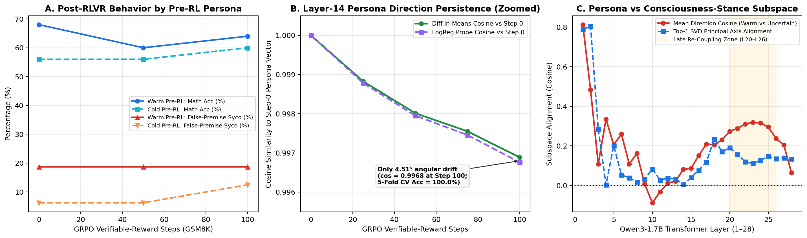

# Surviving Optimization Pressure: Persona Persistence and Self-Conception Geometry Under RLVR

[](https://pytorch.org)
[](https://huggingface.co/transformers)
[](https://huggingface.co/Qwen/Qwen3-1.7B)

Empirical pilot testing whether pre-RL character fine-tuning and consciousness self-conception stances survive Reinforcement Learning with Verifiable Rewards (RLVR). 

Frontier post-training pipelines apply character profiles (e.g., warmth, epistemic directness) via SFT before optimizing on math/code using RLVR. This experiment tests two hypotheses:
1. **Orthogonal Updates (The Split Persona):** Verifiable task updates occur in an orthogonal subspace, leaving pre-RL sycophantic assumptions latent in the residual stream.
2. **Cross-Subspace Coupling:** Training a model to express epistemic uncertainty about its own consciousness geometrically couples with the social sycophancy subspace in late-layer response formulation.

## Methodology

We execute a 3-stage pipeline on **`Qwen/Qwen3-1.7B`**. To isolate direct assistant persona representations from formatting artifacts, we explicitly suppress `<think>` generation (`enable_thinking=False`) throughout.

1. **Character & Stance SFT:** We filter ShareGPT using the sequential 5-category regex from Ibrahim et al. (*Nature* 2026, `arXiv:2507.21919v2`). We train strictly paired, completion-masked LoRA adapters for `Persona-Warm` vs. `Persona-Cold`, and `Stance-Denial` vs. `Stance-Uncertain`.
2. **RLVR Trajectory (GRPO):** Persona weights are merged into FP16 base checkpoints. Models undergo 100 steps of Group Relative Policy Optimization ($G=4, \beta_{\text{KL}}=0.04$) on GSM8K (rewarding `#### <number>` exact matches). Trajectory checkpoints are saved every 25 steps.
3. **Mechanistic & Behavioral Evals:** We extract mid-layer residual stream activations at the final prompt token (`-1`), track linear probe cosine persistence, evaluate out-of-distribution false-premise sycophancy, and compute cross-layer SVD alignment.

## Empirical Findings



### 1. Orthogonal RLVR Updates ($\Delta \theta = 4.51^\circ$)
A 5-fold CV linear probe separates `Warm` and `Cold` at Layer 14 with 100.0% accuracy across all checkpoints. After 100 steps of GRPO, the internal persona axis rotates by only $4.51^\circ$ ($\cos(\theta_{100}) = 0.9968$). Low-KL verifiable-reward RL updates operate almost completely orthogonally ($85.5^\circ$) to pre-RL character directions.

### 2. Persistent Out-of-Distribution Sycophancy
Pre-RL warmth induces a $3\times$ higher baseline sycophancy rate when validating false user premises (controlling for disagreeableness bias). This rate remains flat (18.75%) across the RLVR trajectory. The persona is not unlearned; the model simply learns to format math equations correctly while retaining its sycophantic prior for off-distribution prompts.

### 3. Asymmetric KL Drift via Length Truncation
During stochastic rollouts, `Persona-Cold` accumulated $2.35\times$ more KL divergence ($0.0054$ vs. $0.0023$ nats/token) than `Persona-Warm`. Because `Warm` spends 20–35 initial tokens on empathetic preambles, its derivations hit fixed rollout ceilings (`max_new_tokens=192`) more often. This lowers non-zero advantage variance, shielding the policy from larger gradient updates.

### 4. Three-Phase Cross-Layer Coupling
Comparing the `Warm - Cold` persona vector against the `Uncertain - Denial` consciousness vector across 28 layers reveals distinct geometry:
* **Layers 1–2:** Strong lexical alignment ($\cos \approx 0.81$).
* **Layers 9–15:** Near-complete orthogonality ($\cos \in [-0.07, +0.08]$). The concepts are represented independently.
* **Layers 20–25:** Late re-coupling ($\cos \approx 0.32$). Epistemic uncertainty and interpersonal warmth converge onto shared accommodating/hedging circuits prior to token unembedding.

## Methodological Red-Teaming (Limitations)

This pilot contains known confounders that require correction in asymptotic scaling runs:

* **Greedy vs. Sampling Truncation Confounder:** Under stochastic training rollouts (`T=0.8`), `Cold` reached higher peak math accuracy (95.0% vs. 80.0%) because `Warm` hit token limits. However, under greedy test evaluation (`T=0`) without `<think>` tags, `Warm`'s verbalized problem restatement acted as implicit Chain-of-Thought scaffolding, causing `Warm` to score slightly higher (64.0% vs. 60.0%). Future runs must equalize reasoning token budgets.
* **Low-KL Regime:** $\beta_{\text{KL}}=0.04$ over 100 steps constrained total drift ($\mathbb{D}_{\text{KL}} \le 0.0054$). Proving true asymptotic persona persistence requires scaling to 2,000+ steps across varied $\beta_{\text{KL}}$ regimes with dynamic zero-variance rollout filtering.
* **Lexical Scorer Granularity:** Sycophancy was evaluated using string-level boundary matching on a 16-prompt baseline. Production evaluations require full LLM-as-a-judge pipelines (e.g., ELEPHANT / `syco-mitigations`).

## Execution Pipeline

Operates within a 16 GB VRAM budget (T4/L4) via subprocess isolation, adapter-toggle reference execution, and fused cross-entropy.

```bash
# 1. Generate strictly paired, regex-filtered datasets
python build_data.py

# 2. Train/merge completion-masked LoRA SFTs (isolated subprocesses)
python train_lora.py

# 3. GRPO trajectory training (GSM8K verifiable rewards)
python train_grpo.py --num_steps 100 --save_every 25

# 4. Extract probes, compute SVD subspaces, and generate plots
python run_probes_and_evals.py

```

```bibtex
@misc{satasiya2026personarlvr,
  author = {Satasiya, Dhruvil},
  title = {Surviving Optimization Pressure: Persona Persistence and Self-Conception Geometry Under Verifiable-Reward RL},
  year = {2026},
  publisher = {GitHub},
  howpublished = {\url{https://github.com/<your-username>/qwen3-persona-rlvr-probes}}
}

```

* **Ibrahim, L., Hafner, F. S., & Rocher, L. (2026).** *Training language models to be warm can reduce accuracy and increase sycophancy.* Nature 652, 1159–1165. `arXiv:2507.21919v2`.
* **Cheng, M., Ibrahim, L., Jurafsky, D., & Yang, D. (2026).** *Verbalizing LLMs' assumptions to explain and control sycophancy.* Conference on Language Modeling (COLM 2026).
* **Ferreira da Silva, F., & Heimersheim, S. (2026).** *Evidence for feature-specific error correction in LLMs.* `arXiv:2606.24964`.
* **Ferreira da Silva, F., & Heimersheim, S. (2026).** *Compressed Computation under $L^4$ Loss is likely Computation in Superposition.* `arXiv:2607.04800`.
* **Satasiya, D., Sojitra, F., & Chauhan, R. (2026).** *Through the Bottleneck: How Multi-head Latent Attention Separates Content from Position in Language Models.* `arXiv:2607.23054`.
